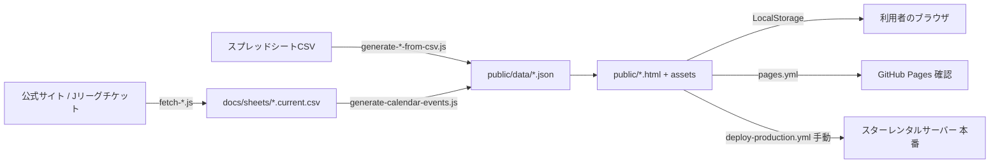

# プロジェクト概要

京都サンガF.C.のサポーター向けに、非公式のWebツールを公開するプロジェクトです。年間スケジュールの確認と参戦予定の保存、予想スカッド画像の作成、チケット販売開始とキックオフを時系列で並べるSUPPORTER TIMELINE、過密日程カレンダー、求・譲投稿フォーマット、アウェイ遠征ガイド、ホーム観戦ガイド（サンガスタジアムへの行き方・散策・亀岡の宿）を提供します。すべてスマートフォンでの利用を最優先し、個人の状態はLocalStorageにだけ保存します。Jリーグチケットの販売情報は、GitHub Actionsが1日1回だけ読み取り、差分をPRとして提案します。公式サイト（sanga-fc.jp）のチケット販売スケジュールとニュース一覧の取得は、2026-10-27から `PAUSE_OFFICIAL_SANGA_FETCH`（既定 `true`）で一時停止しています。再開は同じ変数を `false` に戻します。

## 現在の技術構成

| 分類 | 技術 | 用途 | 根拠となるファイル |
| --- | --- | --- | --- |
| 言語 | HTML / CSS / JavaScript（ES Modules、ビルドなし） | 公開ページと検証スクリプト | `public/*.html`、`public/assets/*.js`、`tools/*.js`、`tools/*.mjs` |
| 言語 | Python 3 | アウェイ遠征ガイドのホテル候補を楽天トラベルAPIから取得する | `tools/hotels/*.py`、`tools/hotels/requirements.txt` |
| 言語 | Python 3 + PyMuPDF（AGPL-3.0、同梱せず手元の仮想環境に入れる） | スタジアム座席図PDFから座席配置 `layout.json` を作る開発用ツール。画面とCIからは使わない | `experiments/stadium-3d/extract/`、`THIRD_PARTY_NOTICES.md` |
| 開発ツール | Blender 4.2（`bpy`、GPL-3.0）+ glTF Transform（MIT）、同梱せず | 座席ビューの構造物に陰影を焼き付けた GLB を作る。画面は URL に `?baked` を付けたときだけ読む | `experiments/stadium-3d/bake/`、`experiments/stadium-3d/baked/`、`THIRD_PARTY_NOTICES.md` |
| ランタイム | Node.js 24 | 検証・生成スクリプトの実行。npm依存なし | `package.json`（`dependencies` なし、lockファイルなし）、`.github/workflows/*.yml` の `node-version: '24'`（`check-latest: true`） |
| フレームワーク | なし（素のDOM操作） | 公開ページはフレームワーク・バンドラを使わない | `public/assets/app.js`、`public/assets/squad-builder.js` |
| UI | 自作CSS、共通トップバー、同梱フォント DM Serif Display | 公開ページの見た目 | `public/assets/style.css`、`public/assets/topbar.css`、`public/assets/dm-serif-display-latin.woff2` |
| UI | modern-screenshot 4.6.5（MIT、静的同梱） | スカッド・日程のPNG生成 | `public/assets/vendor/modern-screenshot/`、`THIRD_PARTY_NOTICES.md` |
| UI | three.js 0.170.0（MIT、jsDelivrから読込、同梱なし） | サンガスタジアム 座席ビューの3D（プロトタイプのみ。`public/` からは読まない） | `experiments/stadium-3d/prototype.html`、`THIRD_PARTY_NOTICES.md` |
| データ保存 | 静的JSON（公開データの正本） | 日程53件、選手39件、ツール一覧、タイムライン用イベント | `public/data/matches.json`、`public/data/players.json`、`public/data/tools.json`、`public/data/calendar-events.json`（生成物） |
| データ保存 | CSV（運用データ・取り込み結果） | チケット販売、アウェイ席、ニュースの現在値と履歴スナップショット | `docs/sheets/*.csv` |
| データ保存 | ブラウザLocalStorage | 参戦予定、表示設定、スカッド保存など個人状態 | `public/assets/app.js`、`public/assets/squad-builder.js`、`docs/personalization.md` |
| 外部サービス | 京都サンガF.C.公式サイト（読み取りのみ） | チケット販売スケジュール、ニュース一覧・記事の取得。2026-10-27から日次ワークフローでは一時停止（`PAUSE_OFFICIAL_SANGA_FETCH=true`）。道具はそのまま残し、`false` で再開する | `tools/fetch-ticket-sales.js`、`tools/fetch-news-list.js`、`tools/fetch-news-articles.js`、`.github/workflows/ticket-sales-sync.yml` |
| 外部サービス | Jリーグチケット（読み取りのみ） | アウェイ席の販売状態と発売日時の取得。2026-10-15からホーム戦の販売段階の開始日時も読み、更新できなくなった公式の販売スケジュールを補う | `tools/fetch-away-tickets.js`、`tools/fetch-away-sales.js`、`tools/parse-home-sales.js` |
| 外部サービス | Cloudflare Web Analytics | Cookieなしのアクセス解析。2026-10-15にトークンを設定。本番以外のホストでは送らない | `public/assets/analytics.js` |
| 外部サービス | 楽天トラベルAPI（VacantHotelSearch） | アウェイ遠征ガイドとホーム観戦ガイドの前泊・当日泊ホテル候補。週1回 `hotels-sync.yml` が取得して下書きPRを作る。認証情報は GitHub Secrets（`RAKUTEN_APP_ID` / `RAKUTEN_AFFILIATE_ID` / `RAKUTEN_ACCESS_KEY`）、許可サイトの判定に Origin ヘッダー（既定は本番ドメイン）を送る | `tools/hotels/rakuten_client.py`、`tools/hotels/build_match_hotels.py`、`.github/workflows/hotels-sync.yml`、`docs/hotels-operation-flow.md` |
| 外部サービス | A8.net（アフィリエイト） | アウェイ遠征ガイドのバス（エアトリ）・宿（じゃらん）と、ホーム観戦ガイドの駐車場（特P、2026-10-16）の提携リンクと計測ピクセル。ホストは検証で px.a8.net / www*.a8.net に制限 | `public/data/affiliates.json`、`tools/validate-stadiums.js` |
| 配信 | iCalendar フィード | タイムラインのカレンダー購読 | `public/timeline.ics`、`public/timeline-events.ics`、`tools/build-ics-feed.js` |
| インフラ・配信 | スターレンタルサーバー（FTP） | 本番公開先。手動ワークフローで `public/` だけを同期 | `.github/workflows/deploy-production.yml`（SamKirkland/FTP-Deploy-Action v4.4.0）、`docs/deploy-policy.md` |
| インフラ・配信 | GitHub Pages | 本番反映前の確認環境。`public/` と `experiments/` を配置 | `.github/workflows/pages.yml` |
| CI | GitHub Actions | 静的検証、スカッドのChromium検証、日次データ取り込み、本番からの取り込み | `.github/workflows/static-checks.yml`、`squad-checks.yml`、`ticket-sales-sync.yml`、`import-production-files.yml` |
| テスト | 自作Node.jsスクリプト（`node --check` と検証ツール） | JS構文、データ契約、公開アセット参照、版数、生成物の一致 | `package.json` の `check:*`、`tools/validate-*.js`、`tools/check-*.mjs` |
| テスト | Playwright 1.62.0 + Chromium（CIで都度インストール） | スカッドの実ブラウザレイアウト検証 | `.github/workflows/squad-checks.yml`、`tools/check-squad-layout.mjs` |
| テスト | 検証用FTPサーバー | 本番取り込みスクリプトの動作確認 | `tools/check-import-tools.mjs` |
| 開発ツール | `tools/asset-versions.mjs` | CSS/JS/JSON/画像の `?v=` を内容ハッシュで揃える | `package.json` の `fix:asset-versions` |
| 開発ツール | `tools/generate-dom-inventory.mjs` | DOMフック一覧 `docs/dom-inventory.md` を実装から生成 | `package.json` の `docs:dom-inventory` |
| 開発ツール | Claude Code スキル humanizer-ja | 公開ページの日本語文言の推敲 | `.claude/skills/humanizer-ja/` |

Lint、フォーマッター、TypeScript、バンドラは使われていません。空白エラーは `git diff --check` でCIが確認します。

## アーキテクチャ

静的サイトと、それを支えるNode.jsスクリプト群、GitHub Actionsの三層です。

- **公開ページ（`public/`）**: 各HTMLが `public/assets/` のCSS/JSを読み、`public/data/` のJSONを `fetch` して描画します。サーバー側の処理はありません。個人状態はLocalStorageに保存し、公開JSONへは含めません。
- **データ生成（`tools/`）**: スプレッドシート由来のCSVから日程・選手JSONを生成します。公式サイトとJリーグチケットから取得したHTMLをCSVに解析し、`generate-calendar-events.js` が `matches.json` と合わせて `calendar-events.json` とICSフィードを組み立てます。
- **自動化（`.github/workflows/`）**: `ticket-sales-sync.yml` が毎日22:00 JSTに取得・解析・生成・検証を行い、差分があればドラフトPRを作ります。2026-10-27から、公式サイト（sanga-fc.jp）の販売スケジュールと公式の案内だけは `PAUSE_OFFICIAL_SANGA_FETCH`（既定 `true`）で取得しません。既存の `ticket-sales.current.csv` と案内のCSVは残し、停止は失敗に数えません。Jリーグチケットのホーム掲載・販売日時・アウェイ席は続けます。再開は同じ変数を `false` にします。手で確かめるアウェイ戦はIssue1本を書き換えて知らせます。取り込みPRは常に1本だけにし、未マージが3日続くか取得が2回続けて失敗したら、別のIssue1本でメンション付きで知らせます。停止中の公式取得は、この連続失敗には入りません。`static-checks.yml` がPRごとに `npm run check:static` と、文書以外の変更時にスカッドのChromium検証を走らせます。
- **配信**: `main` へのpushでGitHub Pagesへ確認用に配置し、本番は `deploy-production.yml` を `DEPLOY` 入力付きで手動実行します。デプロイ前に本番ファイルを暗号化して退避し、`public/` だけをFTPで差分同期します。



## 重要な設計判断

- **依存パッケージを持たない**: `package.json` に `dependencies` がなく、lockファイルもありません。検証は `node --check` と自作スクリプトで完結させ、手元とCIで同じ `npm run check:*` を呼びます。ワークフローYAMLへ検証コマンドを直接書かない方針です（`AGENTS.md`「基本検証」）。
- **Playwrightはリポジトリに入れず、CIで都度インストール**: `squad-checks.yml` が `npm install --no-save --package-lock=false` で固定版を入れます。手元での実ブラウザ検証は任意です。
- **modern-screenshot をCDNではなく静的同梱**: iOS Safariでの画像生成の安定と、公開物の自己完結のためと読めます。`THIRD_PARTY_NOTICES.md` にライセンス表示を集約しています（同梱に切り替えた理由の記録は未確認）。
- **公式サイトへの負荷を抑える**: `robots.txt` の `Crawl-delay: 10` に従い、1日1回・1リクエスト、ステップ間に `sleep 10` を置きます（`ticket-sales-sync.yml` のコメント、`docs/supporter-timeline-design.md`「公式サイトの利用条件」）。2026-10-27から `PAUSE_OFFICIAL_SANGA_FETCH=true` のあいだ、日次ジョブは公式サイトへリクエストを送りません。
- **公式サイトのTLS検証は切らない**: `www.sanga-fc.jp` は葉だけを送る（2026-10-04から取得が `UNABLE_TO_VERIFY_LEAF_SIGNATURE`）。中間証明書 Cybertrust Japan SureServer CA G4 を `tools/certs/cybertrust-japan-sureserver-ca-g4.pem` に置き、`ticket-sales-sync.yml` が `NODE_EXTRA_CA_CERTS` で読む。フィンガープリントは `tools/check-sanga-ca.js` が公開値と突き合わせる。
- **失敗を沈黙させない**: アウェイとホーム戦（Jリーグチケット）の取り込みは `continue-on-error` で本流を止めない一方、最後のステップでジョブを失敗させます。2026-08-31から10日間の失敗に気付けなかった経緯が根拠です。公式サイト（sanga-fc.jp）の販売スケジュールと公式の案内は、サイトが戻るまで取得自体を止めています（`PAUSE_OFFICIAL_SANGA_FETCH=true`）。これは失敗の握りつぶしではなく、壊れた取得先へ毎日取りに行かないための停止です。停止中はジョブを赤くせず、Issueの連続失敗にも足しません。`false` に戻したあとの解析失敗は、これまでどおりジョブの失敗になります。
- **本番デプロイは手動のみ**: 自動デプロイは行わず、`main` かつ `DEPLOY` 入力を要求します。デプロイ前に暗号化バックアップを必須にします（公開リポジトリのアーティファクトは誰でも取得できるため）。
- **LocalStorageの互換性を守る**: 既存キー・保存形式を移行方針なしに変えません。スカッドは新 `squad` 形式を保存しつつ旧 `bench` 形式を読みます（`docs/project-structure.md`）。
- **UIを伴う変更は `experiments/` で先に試す**: 公開物の正本は `public/` で、`experiments/` はGitHub Pagesでだけ参照できます（`docs/ui-prototype-workflow.md`）。
- **入口ページのカードとSEO用ファイルは生成して置く**: 検索エンジンとJavaScript無効の人にも一覧が見えるよう、`tools/build-seo.mjs` が `tools.json` からカードを `index.html` に書き、`sitemap.xml` / `robots.txt` と各ページの `og:image` / canonical をそろえます。`fix:asset-versions` から呼び、`check:seo` でずれを検出します（`docs/site-index.md`）。
- **アクセス解析はCookieなしで、本番ホストだけ**: Cloudflare Web Analytics を選び、トークン未設定のあいだは送信しない形で入れ物だけ先に置いています（`docs/site-index.md`「アクセス解析」）。
- **CSS/JS/JSONのキャッシュ版数は内容ハッシュ**: 生成物と参照の版数ずれで2日続けてCIが落ちた経緯から、`generate:timeline:public` が `fix:asset-versions` まで実行します。`?v=` の付いたJSONは `fetch` の `cache: "no-store"` を使わない（版数がキャッシュキーになる）。版数の無い `data/hotels/*.json` はこれまでどおり `no-store`。各ページは読むJSONを `<link rel="preload" as="fetch" crossorigin="anonymous">` で先に取り、JSの `fetch`（既定の `same-origin`）と二重に取らない。
- **空の箱で下を押さない**: 年間スケジュール、タイムライン、アウェイ／ホーム観戦ガイド、予想スカッドは、JSがJSONを描くまで箱が空で、注記やフッターが一度に下がっていた。描画後の高さに近い `min-height` を `:empty` か `.is-loading` に置き、中身が入ったら外す（2026-10-27、Chromiumで測った値。試合数や開いている月が変わるとずれる）。日程ページは、カードが無いあいだ「該当する試合はありません」を出さない。
- **公開ページの日本語は humanizer-ja で推敲**: 書く人や道具が変わっても同じ基準で読めるよう、スキルをリポジトリ内に置いています（`.claude/skills/humanizer-ja/README.md`）。
- **フレームワークを使わない理由**: 理由未確認。実装上はビルド不要で `public/` をそのまま配置できる利点があります。

## 実行と検証

- **開発環境の起動**: ビルドは不要です。`python3 -m http.server 8123 --directory public` のような静的サーバーで `public/` を配信して確認します（CIと同じ方法）。
- **テスト**:

```bash
npm run check            # check:static と check:squad
npm run check:static     # 日程ページ、タイムライン生成物、公開アセット、取り込みスクリプト
npm run check:squad      # 予想スカッドの構文・データ・静的契約
npm run check:timeline   # チケット販売・アウェイ・ニュース解析と calendar-events
BASE_URL=http://127.0.0.1:8123/squad.html npm run check:squad:browser   # Playwright必須
```

- **生成**: `npm run generate:timeline:public`（`calendar-events.json`、ICS、版数を更新）、`npm run docs:dom-inventory`、`npm run fix:asset-versions`（版数のあと `generate:seo` も実行）、`npm run generate:seo`（入口のカード、sitemap、robots、OGP・canonical）、`node tools/ogp/make-ogp.mjs`（ページ別OGP画像。Playwright必須）。
- **ビルド**: なし。`public/` が配信物そのものです。
- **デプロイ**: `main` へのpushでGitHub Pagesへ自動配置。本番は GitHub Actions「本番サーバー手動デプロイ」を `confirm=DEPLOY` で手動実行します。明示的な指示がある場合だけ実行します。
- **必要な環境変数名（GitHub Secrets）**: `STAR_SERVER_HOST`、`STAR_SERVER_USER`、`STAR_SERVER_PASSWORD`、`STAR_SERVER_PROTOCOL`、`STAR_SERVER_PORT`、`STAR_SERVER_REMOTE_DIR`、`BACKUP_PASSPHRASE`。ホテルツールは `.env` に楽天API認証情報を置く想定です（`.env.example` は未確認）。値はリポジトリに書きません。

## ForLLMとの関連

- `[[AI・自動化]]` — 公式サイトの日次取り込みをGitHub Actionsで自動化し、差分をPR・Issueとして人に渡す運用を実装しています。AIエージェント向けの指示（`AGENTS.md`、`docs/ai/`、`.claude/skills/humanizer-ja/`）も蓄積しており、エージェント運用の実例として参照します。
- `[[UI・デザイン]]` — スマートフォン最優先、44px程度の操作対象、色だけに頼らない表示、ダイアログのフォーカス管理など、公開ページのUI規則を適用する先です。`experiments/` のプロトタイプ運用も含みます。
- `[[開発・トラブルシューティング]]` — 依存なしのNode.js検証、Playwrightの実ブラウザ検証、FTPデプロイの再接続、CIの「失敗を沈黙させない」設計など、運用と障害対応の知識を蓄積します。

上記MOC名は本リポジトリ作成時にVaultを直接確認できていないため、Vault側の実際のMOC名に合わせて修正してください。

## 未解決事項

- **README と実装の不一致**: `README.md`（確認基準日 2026-08-26）は公開サイトを年間スケジュールと予想スカッドの2つとしていますが、`public/data/tools.json` と `docs/project-structure.md` では SUPPORTER TIMELINE、過密日程カレンダー、求・譲投稿フォーマット、入口ページも現役です。
- **THIRD_PARTY_NOTICES と実装の不一致**: `THIRD_PARTY_NOTICES.md` は `public/assets/app.js` が `esm.sh` から modern-screenshot を読み込むと記載していますが、実装は `./vendor/modern-screenshot/modern-screenshot.mjs` を読み込んでいます。`public/experiments/` も既に削除済みです。
- **リポジトリ直下の `undefined/` ディレクトリ**: 入口ページのスクリーンショットPNGが入っていますが、どの文書からも参照されていません。誤って生成された可能性があります。
- **ホテル候補連携**: `tools/hotels/` はサンプル出力のみで、`public/data/hotel-index.json` は0件です。楽天API連携を進めるか止めるかは未決定です。
- **公式由来のロゴ・背番号加工物の利用許諾**: `docs/source-and-license.md` で未確認のままです。
- **フレームワークやビルドツールを使わない判断の理由**: 文書に明示がなく、理由未確認です。
- **ルート `LICENSE` がない**: README が明記しています。方針は未決定です。
- **Node.js の版**: CIは24（`check-latest: true` で最新の24系）を指定しています。Node.js 20 は2026-04-30でサポートが終わったため、2026-10-21のセキュリティ修正（24.22.1）に合わせて上げました。手元の検証は22と24.22.1で通りました。24では `public/assets/ics.js` を `import()` するときに `MODULE_TYPELESS_PACKAGE_JSON` の警告が出ますが、検証の結果には影響しません。
